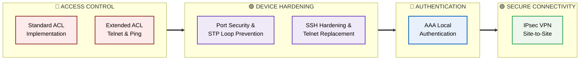
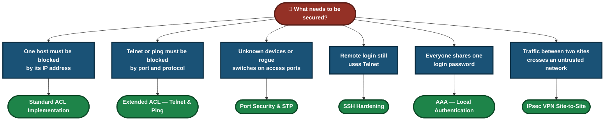
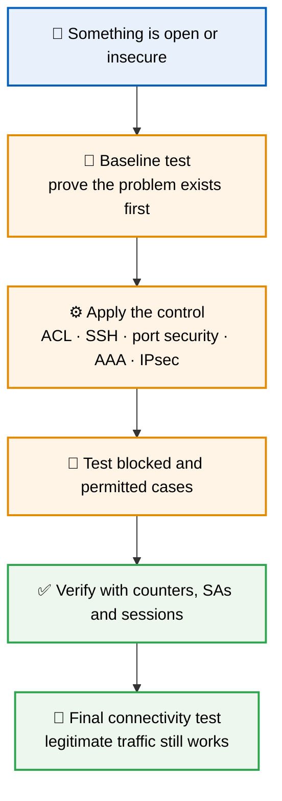
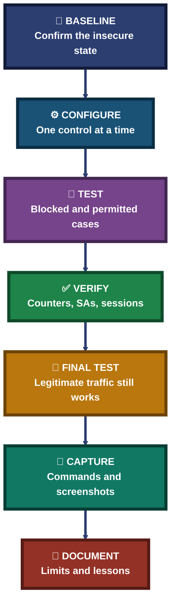

<div align="center">

# 🔴 Network Security Labs — Access Control, Hardening, Authentication & Secure Connectivity

**6 Labs · Access Control → Hardening → Authentication → Secure Connectivity · Simulated Cisco Security Scenarios**

Six hands-on network security labs, each documenting the insecure starting state, the control that fixes it, and the proof that it works — from the first access list to the final encrypted tunnel.


Every lab follows one method: confirm the insecure baseline, apply one control at a time, test what is blocked and what is permitted, verify with command output, and keep the evidence.

### [📂 Jump to the labs](#labs-index)

</div>

---

## 📑 Table of Contents

1. [At a Glance](#at-a-glance)
2. [About This Folder](#about)
3. [Tools & Technologies](#tools)
4. [The Lab Flow](#flow)
5. [Which Lab Do I Need?](#which-lab)
6. [Access Control (2 labs)](#access-control)
7. [Device Hardening (2 labs)](#hardening)
8. [Authentication (1 lab)](#authentication)
9. [Secure Connectivity (1 lab)](#connectivity)
10. [Coverage Snapshot](#coverage-snapshot)
11. [Lab Method Pipeline](#pipeline)
12. [Verification, Not Assumption](#verification)
13. [Command & Tool Cheat Sheet](#cheat-sheet)
14. [Challenges & Fixes at a Glance](#problems-fixes)
15. [Scope & Limitations](#scope-limitations)
16. [What I Learned](#what-i-learned)
17. [Skills Demonstrated](#skills-demonstrated)
18. [Labs Index](#labs-index)
19. [Repo Structure](#repo-structure)

---

<a id="at-a-glance"></a>
## 📊 At a Glance

| 📄 Labs | 🧩 Topic Groups | 🛠 Main Tool | 📁 Each Lab Has |
|:---:|:---:|:---:|:---:|
| **6** | **4** | **Cisco Packet Tracer & IOS command line** | **README · 17 modules · 17 screenshots** |

---

<a id="about"></a>
## 📖 About This Folder

This folder holds six network security labs. Each lab lives in its own folder with a README that documents the scenario, topology, step-by-step configuration, verification, screenshots, challenges, limitations and lessons learned.

- **Access Control:** Standard and extended ACLs that block specific hosts, ports and protocols.
- **Device Hardening:** Replacing Telnet with SSH v2, and protecting switch ports against rogue devices and loops.
- **Authentication:** Replacing a shared password with local AAA accounts and privilege levels.
- **Secure Connectivity:** A site-to-site IPsec VPN tunnel across an untrusted transit router.

> [!NOTE]
> All six labs were built in Cisco Packet Tracer, not on physical hardware. Screenshots are inside each lab folder.

<div align="center">

### 🧩 Lab Workflow at a Glance

<table>
<tr>
<td align="center" valign="top" width="18%">

**🚨 Baseline**<br>
<sub>Confirm the<br>insecure state</sub>

</td>
<td align="center" valign="middle" width="5%">

**➜**

</td>
<td align="center" valign="top" width="20%">

**⚙️ Configure**<br>
<sub>One control<br>at a time</sub>

</td>
<td align="center" valign="middle" width="5%">

**➜**

</td>
<td align="center" valign="top" width="18%">

**🧪 Test**<br>
<sub>Blocked and<br>permitted cases</sub>

</td>
<td align="center" valign="middle" width="5%">

**➜**

</td>
<td align="center" valign="top" width="18%">

**✅ Verify**<br>
<sub>Counters, SAs<br>and sessions</sub>

</td>
<td align="center" valign="middle" width="5%">

**➜**

</td>
<td align="center" valign="top" width="16%">

**📝 Document**<br>
<sub>Commands and<br>evidence</sub>

</td>
</tr>
<tr>
<td colspan="9" align="center">


<br>
<sub>Built-in IOS verification commands, no paid software</sub>

</td>
</tr>
</table>

</div>

---

<a id="tools"></a>
## 🛠️ Tools & Technologies

| Tool | Purpose |
|------|---------|
| Cisco Packet Tracer | Building and simulating every lab topology |
| Router 2911 · Switch 2960 | The routers and switches modeled in the labs |
| Standard & extended named ACLs | Filtering by source IP, and by IP, protocol and port |
| RSA keys, SSH v2, VTY lines | Replacing Telnet with encrypted remote management |
| Port security, sticky MAC, PortFast, BPDU Guard | Protecting switch access ports and the spanning tree |
| AAA local database, privilege levels | Named accounts and per-user access levels |
| IKE phase 1 & 2, transform sets, crypto maps | Building the site-to-site IPsec tunnel |
| `show` commands | Proving each control works with command output |

---

<a id="flow"></a>
## ⏱️ The Lab Flow



<p align="center"><em>The groups show which topic each lab belongs to. Lab numbers are in the Labs Index.</em></p>

---

<a id="which-lab"></a>
## 🧭 Which Lab Do I Need?



---

<a id="access-control"></a>
## 🔴 Access Control (2 labs)

**Goal:** Decide which traffic is allowed and which is blocked, and put the rule on the right router in the right direction.

| Focus | What the Lab Covers | Folder |
|---|---|:---:|
| Standard ACL Implementation | Blocks Branch-PC1 by host IP on Core-R2 while Branch-PC0 stays permitted. Built first as numbered ACL 10, then rebuilt as the named ACL `BLOCK_PC1`, with the old ACL removed. 3 routers, 2 switches, 5 hosts. 17 modules · 17 screenshots. | [📁 Lab](./06-Standard_ACL_Implementation/) |
| Extended ACL — Telnet & Ping Control | One named extended ACL that blocks Branch-Laptop's Telnet (TCP 23) and Branch-PC0's ping to HQ-Server, while Branch-PC1 keeps full access. Each rule's match counter was read separately. 3 routers, 2 switches, 6 hosts. 17 modules · 17 screenshots. | [📁 Lab](./02-Extended_ACL_Telnet_Ping_Control/) |

---

<a id="hardening"></a>
## 🟣 Device Hardening (2 labs)

**Goal:** Close the weak points on the devices themselves — switch access ports and remote management.

| Focus | What the Lab Covers | Folder |
|---|---|:---:|
| Port Security & STP Loop Prevention | Sticky MAC, one MAC per port and violation shutdown on Access-SW2 and Access-SW3, plus PortFast and BPDU Guard. A violation was simulated, the err-disabled ports were recovered, and Root-SW1 was confirmed as STP root before and after. 1 router, 3 switches, 4 hosts. 17 modules · 17 screenshots. | [📁 Lab](./04-Port_Security_STP_Loop_Prevention/) |
| SSH Hardening & Telnet Replacement | Moves Core-R1 and Edge-R2 from Telnet with a shared plaintext password to SSH v2: RSA keys, a local admin account, `transport input ssh`, `service password-encryption` and an exec timeout. 2 routers, 2 switches, 4 hosts. 17 modules · 17 screenshots. | [📁 Lab](./05-SSH_Hardening_Telnet_Replacement/) |

---

<a id="authentication"></a>
## 🔵 Authentication (1 lab)

**Goal:** Replace one shared password with named accounts that can be traced and limited.

| Focus | What the Lab Covers | Folder |
|---|---|:---:|
| AAA — Local Authentication | Three local accounts — admin, user1 and attacker — on HQ-R1 with privilege levels 1, 5 and 15, applied to the console and VTY lines. Admin gets full access, user1 gets limited access, and the attacker's wrong password is rejected. Includes a login banner. 2 routers, 1 switch, 3 hosts. 17 modules · 17 screenshots. | [📁 Lab](./01-AAA_Local_Authentication/) |

---

<a id="connectivity"></a>
## 🟢 Secure Connectivity (1 lab)

**Goal:** Protect traffic between two sites that cross a network you do not control.

| Focus | What the Lab Covers | Folder |
|---|---|:---:|
| IPsec VPN Site-to-Site | A tunnel between HQ-R1 and Branch-R2 across ISP-R. IKE phase 1 uses a pre-shared key, AES, SHA and Diffie-Hellman group 2. Phase 2 uses an ESP-AES / ESP-SHA-HMAC transform set bound by a crypto map. 3 routers, 2 switches, 2 hosts. 17 modules · 17 screenshots. | [📁 Lab](./03-IPsec_VPN_Site_to_Site/) |

### 🔍 Analyst Note — Why the Baseline Test Comes First

Every lab proves the problem exists before applying the fix. A pre-ACL ping test, a Telnet test or a pre-VPN ping shows the starting state, so the later "blocked" or "encrypted" result means something.



---

<a id="coverage-snapshot"></a>
## 🌟 Coverage Snapshot

| 🛡️ Domain | 📌 Where It Appears | ✅ What Is Shown |
|---|---|---|
| Source-Based Filtering | Standard ACL lab | Host deny with wildcard mask, numbered to named ACL migration |
| Port & Protocol Filtering | Extended ACL lab | Telnet and ICMP blocks, inbound and outbound placement, match counters |
| Switch Port Protection | Port Security & STP lab | Sticky MAC, violation shutdown, err-disabled recovery |
| Loop Prevention | Port Security & STP lab | PortFast, BPDU Guard, STP root verification |
| Secure Remote Access | SSH Hardening lab | RSA keys, SSH v2, VTY restriction, password encryption |
| Authentication | AAA Local lab | Local accounts, privilege levels, console and VTY login, rejected attacker |
| Encrypted Tunnels | IPsec VPN lab | IKE phase 1 and 2, transform set, crypto map, encrypt/decrypt counters |

---

<a id="pipeline"></a>
## 🧭 Lab Method Pipeline

How every lab turns an insecure starting state into a verified control



---

<a id="verification"></a>
## ✅ Verification, Not Assumption

A recurring rule across the labs: a control is not done until command output proves it, not just a successful or failed ping.

| Lab | How It Was Handled |
|---|---|
| Standard ACL | Blocked and permitted tests run before and after the numbered-to-named migration, ending with only the named ACL active |
| Extended ACL | Each rule's match counter in `show access-lists` read individually to confirm every line fired |
| Port Security & STP | A real violation simulated by moving a device onto a learned port, ports recovered, STP root re-checked afterwards |
| SSH Hardening | Telnet refused after hardening, and the live session's cipher and Hmac read with `show ssh` |
| AAA Local | Admin, limited user and attacker each tested, so the check covers failure as well as success |
| IPsec VPN | Phase 1 ISAKMP state and Phase 2 encrypt/decrypt counters read separately |

---

<a id="cheat-sheet"></a>
## 🧾 Command & Tool Cheat Sheet

| Command / Tool | Purpose |
|---------|---------|
| `show access-lists` | Verify ACL rules, their order and match counts |
| `show ip interface <int>` | Confirm which ACL is bound to an interface and in which direction |
| `ip access-list extended <name>` · `ip access-group <name> in` | Create a named extended ACL and apply it inbound |
| `crypto key generate rsa` · `ip ssh version 2` · `transport input ssh` | Build the SSH v2 setup and retire Telnet |
| `show ip ssh` · `show ssh` | Check the SSH version, and read live session details |
| `switchport port-security mac-address sticky` · `violation shutdown` | Learn MACs dynamically and shut the port on a violation |
| `spanning-tree portfast` · `spanning-tree bpduguard enable` | Speed up access ports and shut them if a BPDU arrives |
| `show port-security interface <int>` · `show spanning-tree` | Check port security state and the STP root |
| `aaa new-model` · `username <name> privilege <level> secret <pass>` | Enable AAA and create local accounts |
| `show users` · `show aaa local user lockout` | See active sessions and locked accounts |
| `crypto isakmp policy` · `crypto ipsec transform-set` · `crypto map` | Build IKE phase 1, phase 2 and bind them |
| `show crypto isakmp sa` · `show crypto ipsec sa` | Verify the tunnel and the encrypted packet counts |

> The full command summary for each lab is in that lab's README.

---

<a id="problems-fixes"></a>
## ⚠️ Challenges & Fixes at a Glance

| ❌ Challenge | ✅ Solution |
|---|---|
| Ping not blocked by the inbound ACL on Branch-R1 (Extended ACL) | Also applied the ACL outbound on HQ-R3 Gig0/1, filtering closer to the destination |
| Every other host blocked after adding a deny rule (Standard and Extended ACL) | Added the final permit rule, because the implicit deny at the end of an ACL blocks all other traffic |
| `crypto isakmp` command not found (IPsec VPN) | Enabled the `securityk9` license, then ran `write memory` and `reload` on both routers |
| Telnet still worked after SSH was configured (SSH Hardening) | Added `transport input ssh` on the VTY lines |
| Changing a PC's MAC did not trigger a port-security violation (Port Security) | Physically moved the rogue device onto the port after the authorized MAC was sticky-learned |
| Privilege levels not enforced in the simulator (AAA Local) | Documented it as a Packet Tracer limitation rather than hiding it |
| Passwords readable in `show running-config` (AAA Local, SSH Hardening) | Used `secret` instead of `password`, and added `service password-encryption` |
| Every lab | See the Challenges & Fixes section in each lab's README |

---

<a id="scope-limitations"></a>
## 🚧 Scope & Limitations

- **Simulation only:** Every lab was built and verified in Cisco Packet Tracer, not on physical hardware.
- **Simulator quirks are documented:** Privilege-level enforcement is partial, SSH sessions show as version 1.99, and a blocked Telnet can appear as a timeout instead of a refusal.
- **Fundamentals, not production:** Each lab is a single scenario. ACLs have no `log` keyword and a single enforcement point, and the VPN uses one tunnel with a pre-shared key.
- **Local authentication only:** No RADIUS or TACACS+ server was configured, and the AAA lab does not enforce account lockout.
- **1024-bit RSA keys:** Used in the SSH lab because it is the minimum Packet Tracer supports. A production setup would use 2048-bit or larger.
- **Evidence lives in the lab folders:** Screenshots are stored in each lab's folder.

These limits are stated so the labs are read as fundamentals exercises, not production security deployments.

---

<a id="what-i-learned"></a>
## 🧠 What I Learned

- **Rule order and the implicit deny matter.** Forgetting the final permit rule would have blocked every other host, not just the intended target.
- **Counters are proof, a ping is not.** `show access-lists` match counts and `show crypto ipsec sa` encrypt counts show a control is actually working.
- **Turning on a secure protocol does not turn off the insecure one.** SSH only replaced Telnet once `transport input ssh` was set.
- **Port security and BPDU Guard solve different problems.** One stops an unauthorized host, the other stops an unauthorized switch from joining the spanning tree.
- **Named accounts make logins traceable.** A shared password says nothing about who logged in, and `secret` stores a hash where `password` does not.
- **Say what the simulator cannot do.** Documenting its limits is more honest than a config that only looks like it works.

---

<a id="skills-demonstrated"></a>
## 🛠️ Skills Demonstrated

- Writing standard and extended named ACLs with wildcard masks, and choosing where and in which direction to apply them
- Migrating a numbered ACL to a named ACL without leaving the old one active
- Hardening router remote access with SSH v2, RSA keys, VTY transport restriction, password encryption and exec timeouts
- Securing switch access ports with sticky MAC port security, PortFast and BPDU Guard, and recovering err-disabled ports
- Configuring local AAA with privilege levels on the console and VTY lines
- Building a site-to-site IPsec VPN with IKE phase 1 and 2, a transform set and a crypto map
- Verifying controls with match counters, security associations and live session output
- Documenting each lab with commands, screenshots, limitations and lessons

---

<a id="labs-index"></a>
## 📂 Labs Index

| Lab # | Lab | Group | Folder |
|:---:|---|:---:|---|
| 01 | AAA — Local Authentication | Authentication | [`01-AAA_Local_Authentication`](./01-AAA_Local_Authentication/) |
| 02 | Extended ACL — Telnet & Ping Control | Access Control | [`02-Extended_ACL_Telnet_Ping_Control`](./02-Extended_ACL_Telnet_Ping_Control/) |
| 03 | IPsec VPN Site-to-Site | Connectivity | [`03-IPsec_VPN_Site_to_Site`](./03-IPsec_VPN_Site_to_Site/) |
| 04 | Port Security & STP Loop Prevention | Hardening | [`04-Port_Security_STP_Loop_Prevention`](./04-Port_Security_STP_Loop_Prevention/) |
| 05 | SSH Hardening & Telnet Replacement | Hardening | [`05-SSH_Hardening_Telnet_Replacement`](./05-SSH_Hardening_Telnet_Replacement/) |
| 06 | Standard ACL Implementation | Access Control | [`06-Standard_ACL_Implementation`](./06-Standard_ACL_Implementation/) |

---

<a id="repo-structure"></a>
## 📁 Repo Structure

```text
Cisco-Networking-Lab-Portfolio/
|-- 01-Networking/
|-- 02-Network-Security/
|   |-- README.md
|   |-- INDEX-network-security.md
|   |-- 01-AAA_Local_Authentication/
|   |-- 02-Extended_ACL_Telnet_Ping_Control/
|   |-- 03-IPsec_VPN_Site_to_Site/
|   |-- 04-Port_Security_STP_Loop_Prevention/
|   |-- 05-SSH_Hardening_Telnet_Replacement/
|   `-- 06-Standard_ACL_Implementation/
|-- 03-IT-Support-Troubleshooting/
|-- LICENSE
`-- README.md
```

<div align="center">

🔐 **[What is an ACL](https://www.cloudflare.com/learning/access-management/what-is-an-access-control-list/)** · 🔑 **[What is SSH](https://www.cloudflare.com/learning/access-management/what-is-ssh/)** · 🌐 **[What is a VPN](https://www.cloudflare.com/learning/access-management/what-is-a-vpn/)**

[⬅️ Back to Portfolio Root](../README.md)

</div>
